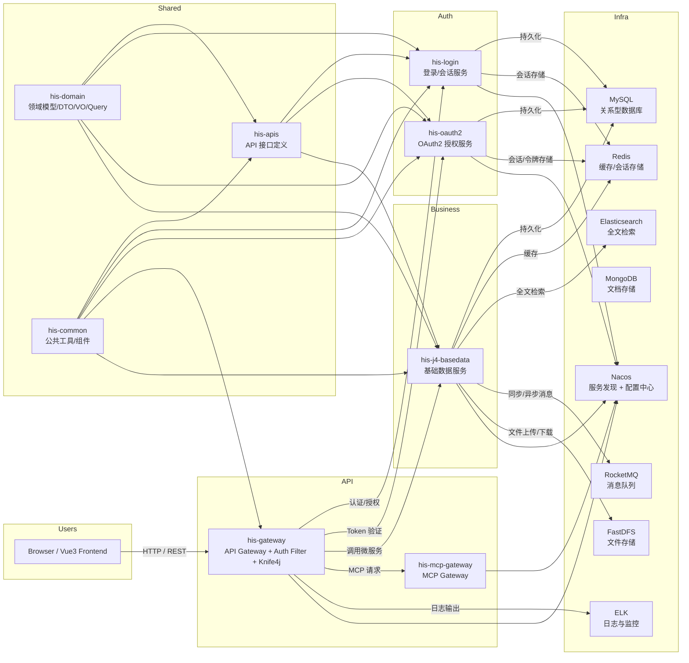

# 项目架构图

## 1. 概览

`zero-one-his` 是一个基于 `Spring Cloud Alibaba` 的微服务型医疗信息系统，当前工作空间中主要包含 Java 后端模块：

- `his-gateway`：统一网关与文档聚合
- `his-login`：登录认证与会话管理
- `his-oauth2`：OAuth2 认证授权服务
- `his-j4-basedata`：基础数据管理模块
- `his-mcp-gateway`：MCP 网关管理服务
- `his-common`：公共工具和基础设施
- `his-domain`：领域模型、DTO/VO/Query 等实体定义
- `his-apis`：接口定义层

另外，项目 README 还提到前端 `Vue3`、C++ 微服务、MySQL、Redis、Nacos、RocketMQ、Elasticsearch、MongoDB、FastDFS、ELK 等外部组件。

---

## 2. 架构关系图（Mermaid）

---

## 3. 模块职责

### his-gateway

- 作为系统统一网关，负责请求转发、路由控制、鉴权和白名单管理
- 集成 `Knife4j` 实现 API 文档聚合
- 依赖 `his-common`、`his-domain`、`his-apis`

### his-login

- 提供用户登录、会话管理、登录信息查询
- 基于 `Spring Boot`、`Spring Security`、`MyBatis Plus` 实现登录业务
- 通过 `Nacos` 注册与发现

### his-oauth2

- 提供 OAuth2 认证/授权能力
- 管理令牌、权限校验与相关安全配置
- 与 `his-login` 共同构成认证/授权层

### his-j4-basedata

- 负责医疗基础数据业务，如：频次、器材、样本、药品、诊断、诊疗等基础数据管理
- 提供基础数据 CRUD、查询、导出等服务
- 依赖领域模型和公共组件

### his-mcp-gateway

- 处理 MCP 服务请求与凭证转发
- 作为 MCP 服务访问入口，允许集中管理额外工具服务
- 支持 `Authorization` 头透传

### his-common

- 公共组件、工具类、基础设施代码
- 封装通用的配置、日志、异常、工具函数等

### his-domain

- 定义系统的领域对象、DTO、VO、Query 等实体
- 提供跨模块共享的模型定义

### his-apis

- 定义业务接口层，规范服务暴露的 API
- 由各业务模块实现，便于模块间解耦与统一文档生成

---

## 4. 运行时边界与调用场景

1. 前端浏览器访问 `his-gateway`，通过统一 API 网关将请求转发至后端业务服务。
2. 网关在入口处做鉴权校验，必要时调用 `his-login` 或 `his-oauth2` 完成登录、令牌验证与授权。
3. 基础数据服务 `his-j4-basedata` 提供核心业务数据接口，并使用 `his-domain` 定义的模型进行数据交换。
4. `his-mcp-gateway` 负责额外的 MCP 请求和工具集成，支持凭证传递。
5. 系统服务通过 `Nacos` 注册与发现，`Redis` 用作缓存与会话存储，`MySQL` 作为主数据存储。

---

## 5. 相关外部系统

- Nacos：服务发现与配置中心
- MySQL：业务数据持久化
- Redis：缓存、会话、分布式锁
- Elasticsearch：检索与搜索能力
- RocketMQ：异步消息与事件总线
- FastDFS：文件存储与上传
- ELK：日志收集、可视化与监控

---

## 6. 结论

当前代码仓库里的 `his-java` 模块已经形成典型的 `Spring Cloud` 微服务架构，清晰分离了：

- API 网关与统一入口
- 认证/授权层
- 业务数据服务层
- 公共组件与模型层
- MCP 管理网关

该文档适合作为源代码阅读前的架构概览。